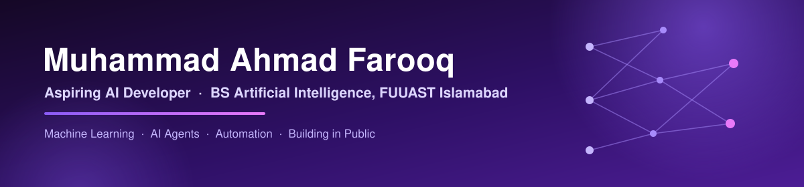

I build practical AI projects in public — step by step and honestly — combining a growing technical foundation with hands-on experience in business and digital marketing.

## Tech I Work With

## GitHub Activity

  
  

## Original Projects

| Project | About | What I Built |
| --- | --- | --- |
| [StudySprint AI](https://github.com/muhammadahmad758/studysprint-ai) | Command-line study coach in pure Python — smart study plans, flashcards & quizzes, spaced repetition, readiness score | My first fully original project — designed and built from scratch, with 23 tests |
| [File Organizer Agent](https://github.com/muhammadahmad758/file-organizer-agent) | A tiny Python agent that tidies messy folders — perceive → decide → act → log, with watch mode, dry-run, undo and custom rules.json | My second fully original project — a complete, safety-first agent with 20 tests |

## Learning Forks

Small, readable open-source projects I study, understand, and improve with one real, tested change each — original authors credited, licenses preserved.

| Project | About | My Contribution |
| --- | --- | --- |
| [Harness from Scratch](https://github.com/muhammadahmad758/harness-from-scratch) | Build a Claude Code–style AI agent harness in 10 steps — learning fork of Sur1ive's project (MIT) | Added a `max_rounds` safety guard to the agent loop — the s01 chapter's own Exercise 1 |
| [Agents from Scratch](https://github.com/muhammadahmad758/agents-from-scratch) | Build an AI agent from first principles with a local LLM — no frameworks, 12 lessons; learning fork of Patric Gutersohn's (pguso) project (MIT) | Added JSON persistence (`save()` / `load()`) to the agent's memory, with tests — so it remembers across restarts |
| [minbpe](https://github.com/muhammadahmad758/minbpe) | Minimal BPE tokenizer — how GPT models turn text into tokens; learning fork of Andrej Karpathy's project (MIT) | Added a Roman Urdu vs English demo comparing token counts for the same meaning |
| [Neural Network from Scratch](https://github.com/muhammadahmad758/neural-network-from-scratch) | NumPy-only neural network — learning fork of Victor Zhou's project (MIT) | Configurable training (`--epochs`, `--learn-rate`, `--seed`) and a training-accuracy report |
| [Chatbot (Ted)](https://github.com/muhammadahmad758/Chatbot) | NLP deep-learning chatbot — learning fork of Karan Malik's project (MIT) | Added a `study_tips` intent and retrained the model |
| [micrograd](https://github.com/muhammadahmad758/micrograd) | Tiny autograd engine — learning fork of Andrej Karpathy's project (MIT) | Added a `tanh()` activation function, with a test |
| [Naive Bayes from Scratch](https://github.com/muhammadahmad758/naive-bayes) | Naive Bayes classifier written from scratch in Python — learning fork of gbroques' project (MIT) | Added a training-set accuracy report to the demo — and reported the honest result it revealed (4/10) |
| [Machine Learning from Scratch](https://github.com/muhammadahmad758/Machine-Learning-from-Scratch) | ML algorithms from scratch in Python notebooks (logistic regression, K-Means, neural nets, RL) — learning fork of curiousily's project (MIT) | Added a `random_seed` option to the K-Means notebook so its colour palettes are reproducible |
| [Regex Engine from Scratch](https://github.com/muhammadahmad758/Regex-Engine-From-Scratch) | A regex engine in pure Python — parser, Thompson NFA, subset construction, Hopcroft-minimized DFA; learning fork of NaxonRO's project (MIT) | Added a `search()` method to the DFA, so a pattern can be found anywhere in a text — full test suite (72 tests) passes |
| [nanoGPT](https://github.com/muhammadahmad758/nanoGPT) | Karpathy's minimal GPT trainer — the transformer in one readable file; learning fork (MIT) | Added a `repetition_penalty` to `generate()` so sampling repeats itself less, wired through `sample.py` |
| [LSTM from Scratch (NumPy)](https://github.com/muhammadahmad758/LSTM-Numpy) | An LSTM (CIFG variant) built from scratch in pure NumPy — a character-level language model on Shakespeare; learning fork of Youness Landa's project (MIT) | Fixed a real input-gate gradient bug in the backward pass and added the repo's first test — a gradient check all 11 parameters now pass |
| [AI Learning Journey](https://github.com/muhammadahmad758/ai-learning-journey) | My AI / ML learning log | Projects, notes, and progress |

## Currently

- **Coursework:** Machine Learning, Linear Algebra, OOP, COAL, DLD
- **Exploring:** AI agents, Generative AI / LLM applications, AI-powered business automation
- **Background:** Meta Ads, digital marketing, branding, and graphic design (Canva, Photoshop) — including a salon management platform concept
- **Goal:** Internship and research experience, then AI roles in Gulf countries and remote teams

---

<em>Serious about learning, honest about my current level, and building towards becoming a skilled AI professional.</em>

